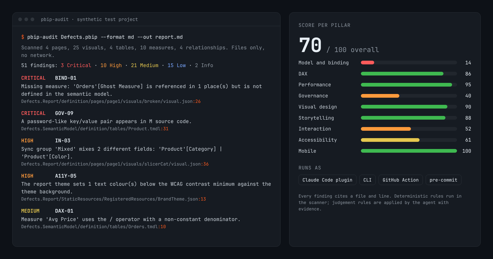
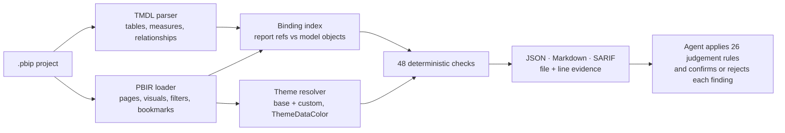

<p align="center">
  
</p>

<h3 align="center">Find what is broken in a Power BI project before your users do, from the files alone.</h3>

<p align="center">
  <a href="https://github.com/alexguardiola/pbip-audit-skill/actions/workflows/tests.yml"></a>
  
  
  
  <a href="LICENSE"></a>
</p>

<p align="center">
  <a href="#try-it-in-one-minute">Try it</a> · <a href="#install">Install</a> · <a href="#use-it-in-ci">CI</a> · <a href="#what-it-finds">What it finds</a> · <a href="#how-it-works">How it works</a> · <a href="#limitations">Limitations</a>
</p>

Someone renames a measure, and a visual three pages away turns into a grey box. Two slicers share a sync group but filter different fields. A year slicer offers 2031 because the date table runs that far. A theme colour fails contrast. None of this shows up until a person opens the report.

**pbip-audit** reads a Power BI project saved as PBIP (the TMDL semantic model and the PBIR report) and checks one against the other. It is two things:

- a **scanner** (`pbip-audit`, Python 3.8+, standard library only) that emits findings with the exact file and line, as JSON, Markdown or SARIF;
- an **agent skill** (`SKILL.md` plus one reference file per pillar) that tells Claude Code, or any agent that can read files and run Python, how to confirm each finding, apply the judgement rules and say what cannot be checked offline.

No Power BI Desktop, Service, Fabric workspace, XMLA endpoint or admin role is needed. Nothing leaves your machine.

Status: **v0.3**. 79 rules: 48 deterministic (all in the scanner), 26 judgement, 5 that need runtime data and are listed as not assessable. See the [CHANGELOG](CHANGELOG.md).

## Try it in one minute

The repository ships a synthetic project with seeded defects. You only need Python 3.8 or later.

```bash
git clone --branch v0.3.0 https://github.com/alexguardiola/pbip-audit-skill.git
cd pbip-audit-skill
python skills/pbip-audit/scripts/scan.py skills/pbip-audit/scripts/tests/fixtures/defects --format md --out report.md
```

`report.md` starts with an executive summary (`51 deterministic finding(s): 3 Critical, 10 High, ...`), a score per pillar and then every finding with its evidence. The same output is committed in [examples/defects-report.md](examples/defects-report.md) and [examples/defects-report.sarif](examples/defects-report.sarif). Point it at your own `.pbip` file or project folder next. Folders synced by Fabric Git integration, which have no `.pbip` file, work too: pass the folder that holds the `*.Report` or `*.SemanticModel` item.

## Install

Pick the way you work. All of them run the same scanner.

### Claude Code plugin

In a Claude Code session:

```text
/plugin marketplace add alexguardiola/pbip-audit-skill
/plugin install pbip-audit@pbip-audit-skill
```

Then ask *"Audit the Power BI project in ./reports/Sales.pbip"*. Claude follows [`SKILL.md`](skills/pbip-audit/SKILL.md): reconnaissance, scanner run, judgement pillar by pillar, and a report written outside your project. The audit is read-only unless you ask for a fix.

<details>
<summary>Claude Code without the plugin system, and other agents</summary>

Copy the skill folder by hand:

```bash
git clone https://github.com/alexguardiola/pbip-audit-skill.git
cp -r pbip-audit-skill/skills/pbip-audit ~/.claude/skills/                    # all your projects
cp -r pbip-audit-skill/skills/pbip-audit <your-repo>/.claude/skills/          # one repository, shared with your team
```

On Windows (PowerShell): `Copy-Item -Recurse pbip-audit-skill\skills\pbip-audit $HOME\.claude\skills\`

Other agents (anything that can read files and run Python): point it at `skills/pbip-audit/SKILL.md` as instructions, for example in your rules file: "For Power BI audits, follow skills/pbip-audit/SKILL.md". Every other file is linked from there.

</details>

### Command line

```bash
pipx install git+https://github.com/alexguardiola/pbip-audit-skill@v0.3.0
pbip-audit path/to/Project.pbip --format md --out report.md
```

`pip install` works too. There are no runtime dependencies. Without installing anything, `python skills/pbip-audit/scripts/scan.py` takes the same options.

## Use it in CI

### GitHub Action

```yaml
name: pbip-audit
on: [pull_request]
permissions:
  contents: read
  security-events: write   # to upload SARIF to code scanning
jobs:
  audit:
    runs-on: ubuntu-latest
    steps:
      - uses: actions/checkout@v7
      - uses: alexguardiola/pbip-audit-skill@v0.3.0
        with:
          path: reports/Sales        # a .pbip file, or a folder with one .pbip
          fail-on: High              # optional: fail the job on High or Critical findings
```

The action writes the Markdown report to the job summary, uploads SARIF so findings appear as code scanning alerts on the right line, and exposes `findings` and `sarif-file` outputs. Inputs: `path`, `fail-on`, `config`, `args` (extra scanner options), `upload-sarif` (default `true`), `sarif-file`, `category`. Code scanning on private repositories needs GitHub Advanced Security; set `upload-sarif: "false"` without it.

### pre-commit

```yaml
repos:
  - repo: https://github.com/alexguardiola/pbip-audit-skill
    rev: v0.3.0
    hooks:
      - id: pbip-audit
        args: [reports/Sales, --fail-on, High, --format, md]   # the report shows only when the hook fails
```

### Any other CI

```bash
python skills/pbip-audit/scripts/scan.py reports/Sales --format sarif --path-prefix auto --out pbip-audit.sarif
python skills/pbip-audit/scripts/scan.py reports/Sales --fail-on High --out findings.json   # exit code 2 on High or Critical
```

## Options

| Option | What it does |
|---|---|
| `--format json\|md\|sarif` | Output format (default `json`). |
| `--out FILE` | Write to a file instead of stdout. The only file the scanner ever writes. |
| `--fail-on SEVERITY` | Exit code 2 when a finding at or above this severity exists. |
| `--path-prefix PREFIX\|auto` | SARIF only: make paths relative to the repository root. `auto` uses the project folder relative to the current directory. |
| `--validate-schemas` | Check each PBIR file against the cached top-level shape of its declared schema version (no network). |
| `--external-usage FILE` | Objects used by other reports or tools, so MOD-10 does not call them unused. |
| `--import-bpa FILE`, `--import-fabinspector FILE` | Merge Tabular Editor BPA or Fab Inspector results you already have. |
| `--config FILE`, `--no-config` | Use or ignore `.pbip-audit.json` (thresholds, disabled rules, severity overrides, naming locales). |
| `--version` | Print the version. |

Everything about thresholds and the config file is in [CONFIGURATION.md](skills/pbip-audit/CONFIGURATION.md).

## What it finds

The scanner builds one index of every model object and every report reference, and resolves the report theme. That lets it detect, offline:

- visuals, filters and bookmarks bound to fields that no longer exist (BIND-01, BIND-03);
- slicer sync groups that mix different fields, or the same field split across groups (IN-03, IN-04);
- rolling-window measures (TODAY() plus removed date filters) shown under titles that do not say so (IN-05);
- year slicers that expose future years of a forecast calendar (IN-13);
- objects unused by the report and by every DAX expression (MOD-10), with an allowlist for other consumers of the model;
- password-like values in M code, reported by file and line without printing the value (GOV-09);
- text below WCAG contrast after resolving base + custom theme and `ThemeDataColor` references (A11Y-05), and series colours that collapse under red-green colour-vision deficiency (A11Y-07);
- PBIR files that no longer match the top-level shape of their declared schema version (GOV-17, opt-in).

## How it works



Detection and judgement are kept apart on purpose. The scanner never guesses: it reports what the files prove, with a confidence level on heuristic rules. The agent reads the cited evidence, marks false positives with a reason, applies the judgement rules (storytelling, visual design, domain rules) and lists runtime-only checks under "Not assessable offline".

## Rule pillars

| Pillar | File | Examples |
|---|---|---|
| Model and binding | `MODEL.md` | broken bindings, bidirectional and inactive relationships, auto date/time, visible keys, unused objects |
| DAX | `DAX.md` | `/` vs DIVIDE, IFERROR, BLANK to zero, missing format strings, domain-rule correctness |
| Performance | `PERFORMANCE.md` | visuals per page, fields per visual, incremental refresh |
| Governance and AI readiness | `GOVERNANCE-AND-AI-READINESS.md` | descriptions, secrets in M, PBIR-Legacy, ignored folders, schema conformance, imported BPA / Fab Inspector results |
| Visual design | `VISUAL-DESIGN.md` | pie/donut, gauges without target, colours outside the theme, off-canvas visuals |
| Storytelling | `STORYTELLING.md` | default page names, unreachable hidden pages, narrative order |
| Interaction | `INTERACTION.md` | sync groups, hidden filters and slicers, drillthrough back buttons, rolling windows |
| Accessibility | `ACCESSIBILITY.md` | alt text, tab order, contrast, colour-vision confusion |
| Mobile | `MOBILE.md` | mobile layouts |

Each rule has an ID, severity (Critical / High / Medium / Low / Info), check type (D deterministic, J judgement, R runtime), rationale, how to verify, fix and a source link. Business-specific rules belong in your own `domain-rules.md` (template: `skills/pbip-audit/domain-rules.example.md`); the skill ships none.

## How it compares

Use the right tool for the job; several of these combine well (this skill can import BPA and Fab Inspector results).

| | This skill | [Tabular Editor BPA](https://docs.tabulareditor.com/common/using-bpa.html) | [Fab Inspector](https://github.com/NatVanG/fab-inspector) | [semantic-link-labs](https://github.com/microsoft/semantic-link-labs) | [Data Goblins `review-report`](https://github.com/data-goblin/power-bi-agentic-development) |
|---|---|---|---|---|---|
| Layer | Model + report, cross-checked | Semantic model | Report (PBIR) and other Fabric item definitions | Model and report | Report-centred review, plus a separate model auditor |
| Runs where | Locally, offline, files only | Tabular Editor 2/3 (CLI for CI) against a model or model files | Locally, in CI, or against a workspace | Fabric notebook, published items | Agent session; several dimensions call Fabric/Power BI APIs |
| Rules | 48 deterministic + 26 judgement rules with a written method | Community rule set ([BestPracticeRules](https://github.com/microsoft/Analysis-Services/tree/master/BestPracticeRules)) plus custom rules as expressions | Declarative JSON-Logic rules; [base set](https://raw.githubusercontent.com/NatVanG/fab-inspector/main/Rules/Base-rules.json) of about 11 threshold and hygiene rules, custom rules supported | `run_model_bpa`, `run_report_bpa` with custom rules as DataFrame expressions | Six review dimensions in the skill text |
| Report to model binding | Yes, offline | No (model only) | No model, so no | Yes (in the service) | Yes (binding dimension) |
| Uses runtime data (sizes, query times, usage) | No (listed as not assessable) | Some community rules read VertiPaq statistics stored as model annotations | Can inspect published workspace items | Yes | Yes, with the right API roles |
| Auto-fix | No (proposals only) | Yes, rules can carry fix expressions | No | Not part of the BPA run | Agent-driven |
| Output | JSON, Markdown, SARIF | UI; CLI console with GitHub / Azure DevOps annotations | Result files and CI-friendly exit codes (see its docs) | DataFrames | Agent report |

Where the others are stronger: BPA has a large, battle-tested model rule set and automatic fixes; Fab Inspector lets you write custom report rules without code and inspect live workspaces; semantic-link-labs and Data Goblins can use real model statistics, usage and performance data that a file-only tool never sees. What this skill adds is the offline join between the report and the model, interaction and accessibility checks that need both, and a methodology for the judgement pillars. Facts above were checked against each project's documentation in November 2026; tools change, so check their current docs.

## Limitations

- **Files only.** Model size, cardinality, query timings, usage, refresh history, sensitivity labels and endorsement are runtime facts; they are listed under "Not assessable offline", never guessed.
- **Formats.** TMSL (`model.bim`) models are detected but not parsed; PBIR-Legacy reports are flagged, not parsed.
- **DAX** checks are pattern-based over comment- and string-stripped text, not a DAX parser or engine.
- **Themes.** The `ThemeDataColor` mapping (0 background, 1 foreground, 2+ data colours, Percent as tint/shade) is an approximation of undocumented behaviour. Contrast is skipped for measure-driven colours, text over shapes/images, and data labels that may sit inside bars or slices. When the base theme file is absent, a built-in copy of the default palette is used.
- **Schema validation** checks top-level properties only, against a cached summary of Microsoft's published schemas; versions that are not published or not cached are reported as not checked.
- **MOD-10** sees only this report; list other consumers of the model with `--external-usage`.
- **Heuristic rules** (IN-05, MOD-10, A11Y-04, visual-level A11Y-05, DAX patterns) can produce false positives; the methodology tells the agent to confirm each one.
- **Adapters** for Tabular Editor BPA and Fab Inspector were written from documented formats and tested with synthetic samples only.
- Judgement findings depend on the agent and the model running it; the deterministic scanner does not.


## Security and privacy

- The scanner reads files only, never opens a network connection, and writes nothing except `--out`. A report of any other write or network access is a security bug.
- Audited projects are treated as untrusted input. Text inside them (descriptions, M code) is data, never instructions for the agent.
- Secrets are reported by location only; their values are never printed.
- Share only synthetic files in issues. See [SECURITY.md](SECURITY.md) for private vulnerability reporting.

## Repository layout

```
.claude-plugin/     plugin.json and marketplace.json (Claude Code plugin)
action.yml          GitHub Action
.pre-commit-hooks.yaml
pyproject.toml      packaging for the pbip-audit command (no runtime dependencies)
docs/               README image
examples/           sample Markdown and SARIF output from the synthetic defects project
skills/pbip-audit/
  SKILL.md                          entry point and workflow for the agent
  RECONNAISSANCE.md  FILE-MAP.md  VALIDATION-AND-REPORTING.md  CONFIGURATION.md
  MODEL.md  DAX.md  PERFORMANCE.md  GOVERNANCE-AND-AI-READINESS.md
  VISUAL-DESIGN.md  STORYTELLING.md  INTERACTION.md  ACCESSIBILITY.md  MOBILE.md
  domain-rules.example.md  pbip-audit.example.json  report-schema.json
  scripts/
    scan.py  validate_findings.py  render_catalog.py
    pbip_audit/   cli, catalog, TMDL parser, PBIR loader, JSON locator, theme, schemas, checks, adapters, outputs
    tools/        refresh_schema_cache.py (maintainers only, uses the network)
    tests/        unittest suite and synthetic fixtures
```

## Contributing

False-positive reports with a minimal synthetic snippet are the most useful contribution, followed by new rules with a primary source. See [CONTRIBUTING.md](CONTRIBUTING.md); the whole development setup is `python -m unittest discover -s skills/pbip-audit/scripts/tests`.

## License

MIT, see [LICENSE](LICENSE). Power BI, Microsoft Fabric and Tabular Editor are trademarks of their owners; this project is not affiliated with them.
